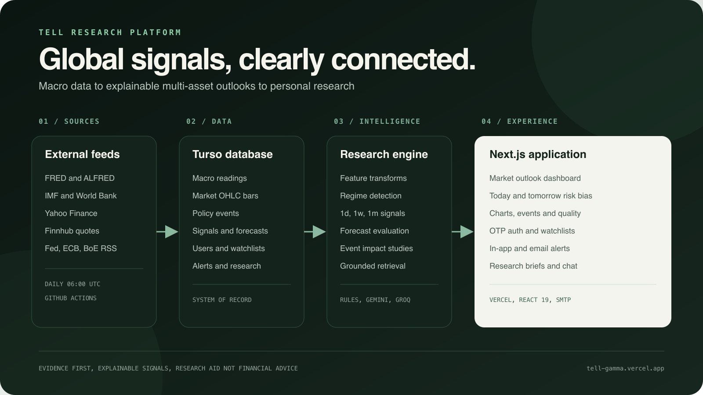
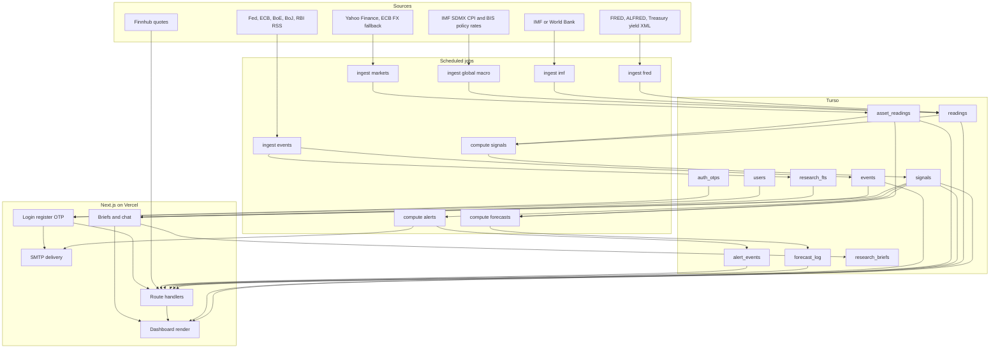

# Architecture



Tell separates three concerns: data collection, offline scoring, and request-time presentation. Anything expensive or rate-limited runs in scheduled scripts and lands in Turso; the web application only reads stored facts and adds optional language-model narration.

## Design principles

1. **Turso holds the truth.** Every number shown in the UI is traceable to a stored row.
2. **Scoring is deterministic.** Outlooks come from transparent rules (`rules-v2`), not opaque models.
3. **Language models explain, they do not predict.** Briefs and chat are grounded in retrieved evidence.
4. **The daily job stays cheap.** Only free data sources run on schedule; paid or key-limited AI work is manual.
5. **Every claim is measured.** Signals are graded against realized returns in `forecast_log`.

## Layers

| Layer | Responsibility | Location |
| ----- | -------------- | -------- |
| Persistence | Schema and client for Turso/libSQL | `db/schema.sql`, `src/lib/db.ts` |
| Reference data | Countries, indicators, assets | `src/data/seed.ts` |
| Source adapters | HTTP clients for each provider | `src/lib/fred.ts`, `imf.ts`, `worldbank.ts`, `yahoo.ts`, `quotes.ts`, `rss.ts` |
| Ingestion | CLI jobs that upsert provider data | `scripts/ingest-*.ts` |
| Feature engine | Pure transforms over stored series | `src/lib/features/*` |
| Signal engine | Rule scoring and persistence | `src/lib/signals/*` |
| Evaluation | Forward returns and hit rates | `src/lib/forecasts/*` |
| Product domains | Events, alerts, watchlist, macro, risk, AI | `src/lib/{events,alerts,watchlist,macro,risk,ai}/*` |
| HTTP surface | Route handlers and query services | `src/app/api/**`, `src/lib/api/*` |
| Interface | Server-rendered dashboard and panels | `src/app/*`, `src/components/*` |
| Identity and delivery | Sessions (email/username JWT), OTP, SMTP | `src/lib/auth.ts`, `src/lib/auth/otp.ts`, `src/lib/email/*` |

## Data flow



## Request paths

The home page is `force-dynamic` and reads Turso directly during server rendering, so first paint needs no client fetch:

```ts
// src/app/page.tsx
const [signals, watchlist, macroStrip, nearTermBias] = await Promise.all([
  listLatestOutlook(db),
  session ? listWatchlist(db, session.sub) : Promise.resolve([]),
  getMacroStrip(db, { limit: 24 }),
  getNearTermRiskBias(db),
]);
```

Interactive panels then call the API for detail: charts, event impact, forecast quality, alerts, briefs, and chat. Live quotes are fetched only when explicitly requested with `?live=1`, only during the NYSE session, and through a shared 60-second cache (at most one Finnhub call per symbol per minute). A quote failure never fails the outlook response.

## Offline pipeline

| Step | Command | Writes |
| ---- | ------- | ------ |
| 1 | `npm run ingest:fred` | `readings` (current vintage plus ALFRED vintages for priority series) |
| 2 | `npm run ingest:imf` | `readings` for cross-country indicators |
| 3 | `npm run ingest:global-macro` | `readings` for `CPI_YOY_M` (IMF SDMX) and `POLICY_RATE` (BIS) |
| 4 | `npm run ingest:markets` | `asset_readings` |
| 5 | `npm run ingest:companies` | `company_snapshots` (market-map caps, needs `FINNHUB_API_KEY`) |
| 6 | `npm run ingest:events` | `events`, `research_fts` |
| 7 | `npm run compute:signals` | `signals` |
| 8 | `npm run compute:forecasts` | `forecast_log` |
| 9 | `npm run compute:alerts` | `alert_events`, alert email |

Manual, key-dependent extras:

| Command | Purpose |
| ------- | ------- |
| `npm run backfill:signals` | Rebuild historical signals so hit rates have sample size |
| `npm run compute:briefs` | Persist Gemini briefs for the universe |
| `npm run compute:watchlist-briefs` | Per-user watchlist brief plus email |
| `npm run test:eval` | Live model quality eval, gated by `TELL_AI_EVAL=1` |

`compute:features` prints a diagnostic snapshot; production scoring builds features inside `compute:signals`.

## Repository layout

```text
tell/
├── .github/workflows/
│   ├── ci.yml                        # lint, format, types, unit, build, e2e
│   └── ingest.yml                    # 4× daily UTC ingest pipeline
├── db/schema.sql                     # Turso schema, idempotent
├── docs/                             # documentation + architecture diagram
│   ├── tell-architecture.svg
│   └── tell-architecture.png
├── e2e/                              # Playwright specs
├── scripts/                          # CLI pipeline entry points
│   ├── migrate.ts  seed.ts
│   ├── ingest-fred.ts  ingest-imf.ts  ingest-global-macro.ts
│   ├── ingest-markets.ts  ingest-companies.ts  ingest-events.ts
│   ├── compute-features.ts  compute-signals.ts  compute-forecasts.ts
│   ├── compute-alerts.ts  compute-briefs.ts  compute-watchlist-briefs.ts
│   ├── backfill-signals.ts  eval-ai.ts
├── src/
│   ├── proxy.ts                      # rate-limits + JWT auth for every /api/*
│   ├── app/
│   │   ├── page.tsx                  # dashboard, server rendered
│   │   ├── map/                      # market treemap, server rendered
│   │   ├── login/  register/  methodology/  system/
│   │   ├── error.tsx  loading.tsx  layout.tsx  globals.css
│   │   └── api/                      # 29 route handlers
│   ├── components/                   # dashboard and panels
│   ├── data/seed.ts                  # countries, indicators, assets
│   ├── data/companies.ts             # market-map company list
│   ├── data/market-sizes.ts          # dated market sizes with sources
│   └── lib/
│       ├── ai/                       # brief, chat, context, rag, cache, rate limit
│       ├── alerts/                   # rule evaluation and store
│       ├── api/                      # outlook, charts, health, readings, http
│       ├── auth/                     # OTP lifecycle
│       ├── email/                    # mailer and templates
│       ├── events/                   # ingest, enrich, impact, store
│       ├── features/                 # macro, market, regime, series, stats
│       ├── forecasts/                # forward return and quality
│       ├── macro/                    # sparkline strip
│       ├── market-map/               # treemap views, company snapshots
│       ├── risk/                     # near-term bias
│       ├── signals/                  # score, horizons, backfill, store
│       ├── watchlist/                # user symbol store
│       ├── auth.ts  db.ts  password.ts  session-token.ts
│       └── fred.ts  imf.ts  worldbank.ts  yahoo.ts  quotes.ts  rss.ts
├── .env.example  Makefile  package.json  README.md
├── playwright.config.ts  vitest.config.mts  vitest.setup.ts
└── next.config.ts  tsconfig.json  eslint.config.mjs
```

## Asset universe

Seeded countries: `US`, `CA`, `BR`, `GB`, `DE`, `FR`, `CH`, `IN`, `CN`, `JP`, `KR`, `TW`, `AU`. `src/data/seed.ts` is the source of truth; `syncCatalog` upserts it on every migrate and e2e setup.

| Class | Group | Symbols |
| ----- | ----- | ------- |
| Equity | Country markets | `SPY`, `EWC`, `EWZ`, `EWU`, `EWG`, `EWQ`, `EWL`, `INDA`, `MCHI`, `EWJ`, `EWY`, `EWT`, `EWA` |
| Equity | US sectors | `XLK`, `XLC`, `XLY`, `XLP`, `XLV`, `XLF`, `XLI`, `XLE`, `XLB`, `XLU`, `XLRE` |
| Currency | Dollar index, majors, emerging | `DXY`, `EURUSD`, `GBPUSD`, `USDJPY`, `USDCHF`, `AUDUSD`, `USDCAD`, `USDCNY`, `USDINR` |
| Commodity | Precious, industrial, energy, agriculture | `GOLD`, `SILVER`, `PLATINUM`, `COPPER`, `WTI`, `BRENT`, `NATGAS`, `WHEAT`, `CORN`, `SOYBEAN` |
| Crypto | | `BTCUSD`, `ETHUSD` |
| Rates | Treasuries | `IEF`, `TLT` |
| Credit | IG, high yield, EM debt | `LQD`, `HYG`, `EMB` |
| Cash | T-bills (not scored) | `SHV` |

Commodities are continuous front-month futures from Yahoo (`GC=F`, `CL=F`, …), so the price is the commodity itself, not an ETF that drifts from roll costs. Grains are quoted in US cents per bushel. Every instrument runs on a Monday–Friday calendar: weekend crypto and FX bars are dropped at parse time, and their weekend move lands in Monday's return. Taiwan has no IMF or BIS macro coverage, so its local inflation and policy-rate strip stays empty.

## Market map

`/map` draws a treemap of where money sits and how it moved over 1 day, 1 week or 1 month. It has five views: asset classes, country stock markets, the largest companies, US sectors, and every tracked instrument at equal size. `getMarketMap` reads the last 22 bars per symbol plus the company snapshots, and the pure builders in `src/lib/market-map/views.ts` turn those into nested tiles. Group colour is the size-weighted change of its children.

Sizes come from published, dated figures in `src/data/market-sizes.ts`, each with its source and date:

- WFE (with Euronext and World Bank where WFE has gaps) for domestic market capitalisation per country.
- SIFMA for global equity and bond totals.
- World Gold Council for above-ground gold.
- The issuance schedule for Bitcoin supply, and Etherscan for Ether supply.
- S&P Dow Jones Indices for sector weights.

Country and sector sizes are rolled forward by their proxy ETF's price change since the published date; gold and crypto use the latest price. Bond sizes are not rolled forward. Company market caps come from Finnhub `profile2`, converted to US dollars with Yahoo FX, and stored daily by `ingest:companies`.

`GLD` and `USO` were retired in favour of `GOLD` and `WTI`; `RETIRED_SYMBOLS` in `src/lib/catalog.ts` moves watchlists and drops their history.

## Runtime dependencies

| Concern | Dependency | Required |
| ------- | ---------- | -------- |
| Hosting | Vercel, Next.js 16.3, React 19 | Yes |
| Database | Turso through `@libsql/client` | Yes |
| Sessions | `JWT_SECRET` with `jose`, `bcryptjs` hashes | Yes |
| US macro | FRED with `FRED_API_KEY`; Treasury yield XML for same-day 2Y/10Y | For ingest |
| Cross-country macro | IMF DataMapper, World Bank fallback | No key |
| Local monthly macro | IMF SDMX 3.0 CPI, BIS central bank policy rates | No key |
| Market bars | Yahoo Finance; ECB reference rates (Frankfurter) when Yahoo FX is empty | No key |
| Live quotes | Finnhub with `FINNHUB_API_KEY` (US-listed ETFs; no FX on free tier) | Optional |
| Policy events | Fed, ECB, BoE, BoJ, RBI RSS | No key |
| Briefs and chat | `GEMINI_API_KEY`, `GROQ_API_KEY` | Optional |
| Email | SMTP through Nodemailer | Needed for OTP registration |
| CI | Node 22, Playwright Chromium | Yes |

## Failure behavior

| Condition | Result |
| --------- | ------ |
| Missing AI keys | Brief and chat endpoints return `503`; UI shows an unavailable state |
| Missing SMTP | OTP requests return `503` unless local `TELL_OTP_DEV_ECHO=1` (blocked when `APP_ENV` is production-like); alert email is skipped, inbox still written |
| Live quote failure / `LIVE_MARKET_QUOTES=false` | Outlook still returns with `quote: null` |
| IMF blocked from cloud IPs | Cross-country ingest falls back to World Bank and preserves existing IMF rows |
| `research_fts` not migrated | Retrieval indexing is skipped silently |
| Missing required env | `/api/health` and `/api/ready` return `503` with the missing names |

Related reading: [Data model](DATA-MODEL.md), [Signal methodology](SIGNALS.md), [API reference](API.md), [Operations](OPERATIONS.md).
